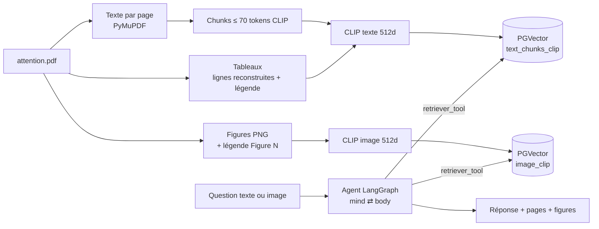
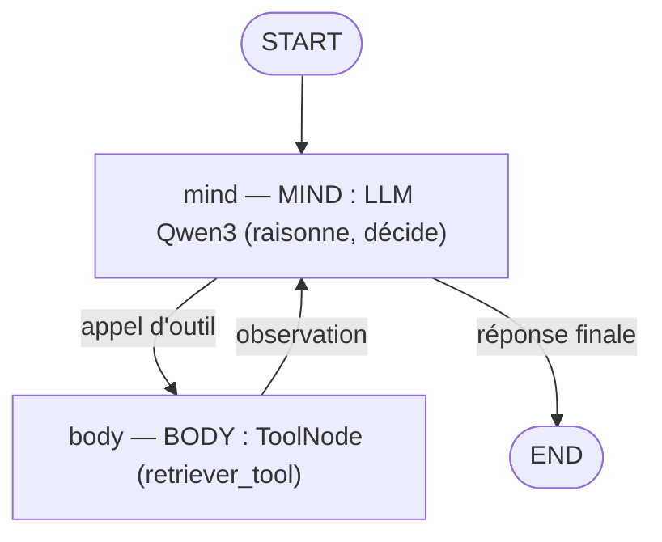

# RAG multimodal et agentique — *Attention Is All You Need*

Application qui **extrait, indexe et interroge** le texte, les tableaux et les figures d'un PDF,
avec un **agent ReAct** (LangGraph) qui décide lui-même quand et comment chercher.
Tout est open source et tourne en local (CPU suffisant).

**Stack :** PyMuPDF · LlamaIndex · CLIP ViT-B-32 (sentence-transformers) · PostgreSQL/PGVector ·
LangChain/LangGraph · Ollama (Qwen3) · Streamlit

---

## Architecture



### Graphe de l'agent (ReAct)



---

## Correspondance avec l'énoncé

| Étape | Exigence | Implémentation |
|---|---|---|
| 1 | Extraire le texte (pages/chunks) et les images | `ingest.py` : texte par page, découpage en chunks de ≤ 70 tokens CLIP (161 chunks). Bonus : 3 tableaux reconstruits ligne par ligne. `ingest_images.py` : 3 figures enregistrées en PNG dans `data/images/` |
| 2 | Embeddings multimodaux CLIP + normalisation | `clip_embeddings.py` : CLIP ViT-B-32 (512 d), même espace pour le texte et les images, normalisation L2 vérifiée par `check_embedding` |
| 3 | Base vectorielle, ID SHA-256, métadonnées | PGVector (Docker). Clé `doc_sha256`, identifiants de chunks déterministes, suppression par document avant réindexation. Métadonnées : `type`, `page`, `image_path`, `caption`, `position` |
| 4 | Recherche cosinus (requête texte **ou** image), top-k | `agent_rag.retrieve()` : texte→texte, texte→tableau, texte→image, image→texte, image→image. Affichage du top-k : `agent_rag.py` (CLI, `--show`) et Streamlit |
| 5 | Le retriever comme outil (`retriever_tool`) | `agent_rag.retriever_tool` : arguments typés en Pydantic (`query`, `modality`, `image_path`, `k`) et description qui guide le LLM |
| 6 | Agent ReAct MIND/BODY avec LangGraph | `graph_agent.py` : `StateGraph` explicite (`mind` → `body` → `mind`), `compile()`, limite d'étapes, trace Reasoning / Action / Observation / Answer |
| 7 | Tests et analyse du comportement | `evaluate_agent.py` : 8 requêtes, 4 indicateurs, rapports dans `results/`, et la section *Analyse* ci-dessous |

---

## Installation

Prérequis : [uv](https://docs.astral.sh/uv/), Docker, [Ollama](https://ollama.com).

```bash
docker compose up -d                 # PostgreSQL + pgvector (port 5433)
ollama pull qwen3:1.7b               # LLM par défaut de l'agent
uv sync                              # environnement Python
```

Variables d'environnement utiles :

| Variable | Rôle |
|---|---|
| `RAG_LLM` | Modèle Ollama de l'agent (défaut : `qwen3:1.7b`) |
| `HF_HUB_OFFLINE=1` | Évite les appels réseau vers Hugging Face une fois CLIP téléchargé |
| `UV_CACHE_DIR` | Emplacement du cache uv (utile si le disque système est plein) |

---

## Utilisation

### 1. Indexation
```bash
uv run python ingest.py data/attention.pdf          # texte + tableaux
uv run python ingest_images.py data/attention.pdf   # figures + légendes
```
Ou bien restaurer directement la base fournie (sur une base vide) :
```bash
docker cp dump.sql rag_pg:/tmp/dump.sql
docker exec rag_pg psql -U rag -d rag -f /tmp/dump.sql
```

### 2. Recherche multimodale directe (sans agent)
```bash
uv run python agent_rag.py "BLEU score of the big Transformer" --modality table -k 2
uv run python agent_rag.py "Transformer architecture diagram" --modality image -k 3 --show
uv run python agent_rag.py --image data/images/a0efa62491d3_p4_img2.png --modality text -k 3
uv run python agent_rag.py --image data/images/a0efa62491d3_p4_img2.png --modality image -k 3
```

### 3. Agent (cycle ReAct affiché)
```bash
uv run python rag.py "What BLEU score does the big Transformer reach on English-to-German?"
uv run python graph_agent.py --mermaid     # graphe de l'agent au format Mermaid
uv run streamlit run app.py                # interface web
```

### 4. Évaluation et tests
```bash
uv run python evaluate_agent.py --model qwen3:1.7b
uv run python evaluate_agent.py --only q2 q6
uv run pytest tests -q                     # 12 tests
```

---

## Choix techniques

- **Chunks de 70 tokens CLIP.** CLIP ne lit que 77 tokens et coupe le reste sans prévenir.
  Le découpage compte donc les tokens avec le tokenizer de CLIP, et chaque chunk est
  vectorisé en entier.
- **Tableaux reconstruits à partir de la position des mots.** L'extraction directe de PyMuPDF
  produisait des nombres abîmés (`"284\n."` au lieu de 28.4). CLIP vectorise la **légende**
  du tableau, et le LLM reçoit le tableau complet.
- **Légendes des figures.** La légende « Figure N: … » est rattachée à chaque image. Pour la
  Figure 2, qui contient deux images, la partie gauche ou droite est détectée à partir des
  coordonnées.
- **Clé `doc_sha256` et non `document_id`.** À l'enregistrement dans le vector store,
  LlamaIndex écrase les clés `document_id`, `doc_id` et `ref_doc_id`. Un filtre sur
  `document_id` ne trouvait donc rien, et la réindexation créait des doublons.
- **Pas de classement commun texte/image.** Avec CLIP, les scores texte-texte (environ 0,85)
  et texte-image (environ 0,28) ne sont pas comparables : c'est l'écart de modalité.
  En mode `all`, l'outil renvoie donc les textes et tableaux, puis la meilleure figure à part.
- **Recherche hybride.** Une requête qui cite « Figure N » ou « Table N » ramène toujours
  l'élément cité (filtre sur sa légende), quelle que soit la modalité choisie par le LLM.
- **Garde-fous de l'agent.** Au moins 3 résultats par recherche (`k ≥ 3`), une limite
  d'étapes dans le graphe, et la détection d'une génération coupée (`done_reason = "length"`).

---

## Résultats (CPU, sans GPU)

8 requêtes : texte, tableaux (dont une comparaison en plusieurs étapes), figure, question
hybride texte + figure, requête par image et question hors document. Le détail est dans
`results/`.

| Modèle | Appel d'outil | Modalité pertinente | Bonne page retrouvée | Réponse correcte | Durée / question |
|---|---|---|---|---|---|
| `qwen3:4b` (variante *thinking* 2507) | 0/8 | 0/8 | 0/7 | 1/8 (faux positif) | 70–110 s |
| `qwen3:1.7b` | **8/8** | **8/8** | **6/7** | **4/8** | 20–47 s |
| `qwen3:4b-instruct-2507` | à compléter | | | | |

---

## Analyse du comportement de l'agent

**1. La décision d'appeler l'outil.** Avant les améliorations, qwen3:1.7b choisissait souvent
`modality="text"` pour des chiffres, demandait parfois `k=1`, puis inventait la réponse :
« 24.6 BLEU » (la ligne GNMT+RL) au lieu de 28.4, et une « attention intramétrique » qui
n'existe pas dans l'article. Avec la recherche hybride, le minimum `k ≥ 3` et des exemples
d'appels dans le prompt, l'agent appelle l'outil 8 fois sur 8, avec une modalité pertinente.

**2. La recherche (CLIP).**
- Texte → tableau : le Tableau 2 sort en premier (0,797).
- Texte → image : la Figure 1 n'arrive que 3e (0,266 contre 0,271). CLIP distingue mal des
  schémas scientifiques entre eux.
- Image → image : 0,852 et 0,775 entre figures différentes. Pour CLIP, tous les diagrammes
  noir sur blanc se ressemblent.
- Image → texte : scores bas (environ 0,33), mais le premier passage est pertinent
  (« …scaled dot-product attention… See Figure 2 »).

**3. La génération.** Avec qwen3:1.7b, la recherche retrouve la bonne page dans 6 cas sur 7,
mais seulement 4 réponses sur 8 sont correctes. Le facteur limitant n'est plus la recherche :
c'est la lecture des résultats par un petit modèle. Les échecs (q1, q4, q5, q8) sont détaillés
dans `results/eval_qwen3-1-7b_*.md`. Les indicateurs reposent sur des mots-clés et doivent
être relus.

**4. Le budget de réflexion.** La variante *thinking* de qwen3:4b réfléchit même quand on lui
demande de ne pas le faire. Ses 512 tokens autorisés s'épuisent avant toute action. Exemple
(q4) : la sortie s'arrête net sur *« So the correct function call is retriever_tool with »*.
Le cycle ReAct n'atteint jamais l'étape Action, d'où 0 appel d'outil. Un modèle plus gros
n'est donc pas forcément un meilleur agent : sur CPU, un modèle sans réflexion est plus fiable
et 2 à 3 fois plus rapide.

---

## Limites et pistes d'amélioration

- **CLIP pour la recherche texte→texte.** Un modèle d'embedding de texte dédié (bge, e5)
  serait plus précis. On garderait CLIP pour les requêtes qui croisent texte et image.
- **Description des figures par un VLM.** Une option existe déjà (`USE_VLM_DESCRIPTION` dans
  `ingest_images.py`, avec moondream), mais ses descriptions sont à vérifier.
- **Un reranker** pour réordonner les résultats avant de les donner au LLM.
- **Un GPU et un modèle instruct plus grand (7–8B)** pour améliorer la lecture des tableaux
  et le raisonnement en plusieurs étapes.

---

## Structure du dépôt

```
├── clip_embeddings.py   # CLIP ViT-B-32, normalisation L2
├── ingest.py            # texte + tableaux -> PGVector
├── ingest_images.py     # figures + légendes -> PGVector
├── agent_rag.py         # recherche multimodale + retriever_tool (+ CLI)
├── graph_agent.py       # agent ReAct LangGraph (mind / body)
├── rag.py               # CLI de l'agent (trace ReAct)
├── app.py               # interface Streamlit
├── evaluate_agent.py    # évaluation (étape 7)
├── results/             # rapports d'évaluation (.md / .json)
├── tests/               # tests pytest
├── data/                # attention.pdf + figures extraites
├── dump.sql             # sauvegarde de la base vectorielle
└── docker-compose.yml   # PostgreSQL + pgvector
```