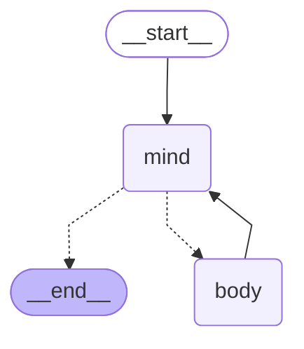

# Évaluation de l'agent RAG multimodal — `qwen3:1.7b`

Date : 2026-11-15 13:10

## Graphe de l'agent (LangGraph)



## Synthèse

| Id | Catégorie | Outil appelé | Appels | Modalités | Modalité OK | Bonne page retrouvée | Réponse OK | Durée (s) |
|---|---|---|---|---|---|---|---|---|
| q2 | tableau | ✅ | 1 | table | ✅ | ✅ | ✅ | 31.9 |

- Appel d'outil : **1/1**
- Modalité pertinente : **1/1**
- Bonne page retrouvée : **1/1**
- Réponse correcte : **1/1**
- Durée moyenne : **31.9 s**

## Détail des cycles ReAct

### q2 — tableau

**Question :** Quel score BLEU le Transformer (big) obtient-il sur la traduction anglais-allemand ?

1. **Action** — `retriever_tool({"query": "BLEU score Transformer (big) translation English to German", "modality": "table"})`

2. **Observation**

```text
[1] (tableau, page 8, score 0.763)
Table 2: The Transformer achieves better BLEU scores than previous state-of-the-art models on the English-to-German and English-to-French newstest2014 tests at a fraction of the training cost.

BLEU | Training Cost (FLOPs)
Model
EN-DE | EN-FR | EN-DE | EN-FR
ByteNet [15] | 23.75
Deep-Att + PosUnk [32] | 39.2 | 1.0 · 1020
GNMT + RL [31] | 24.6 | 39.92 | 2.3 · 1019 | 1.4 · 1020
ConvS2S [8] | 25.16 | 40.46 | 9.6 · 1018 | 1.5 · 1020
MoE [26] | 26.03 | 40.56 | 2.0 · [...]
```

3. **Answer**

Le Transformer (big) obtient un score BLEU de **28.4** sur la traduction anglais-allemand. Ce score est répertorié dans le tableau page 8, sous la colonne "BLEU" pour le modèle Transformer (big).

**Indicateurs :** outil ✅ · modalité ✅ · page ✅ · réponse ✅ · 31.9 s

---
