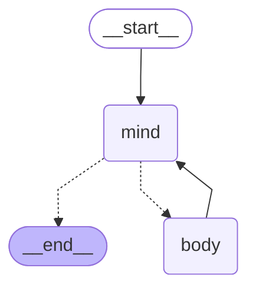

# Évaluation de l'agent RAG multimodal — `qwen3:4b-instruct-2507-q4_K_M`

Date : 2026-11-15 13:41

## Graphe de l'agent (LangGraph)



## Synthèse

| Id | Catégorie | Outil appelé | Appels | Modalités | Modalité OK | Bonne page retrouvée | Réponse OK | Durée (s) |
|---|---|---|---|---|---|---|---|---|
| q1 | texte | ✅ | 1 | text | ✅ | ❌ | ❌ | 86.6 |
| q2 | tableau | ✅ | 1 | table | ✅ | ✅ | ✅ | 58.8 |
| q3 | tableau | ✅ | 1 | table | ✅ | ✅ | ❌ | 55.9 |
| q4 | tableau (multi-étapes) | ✅ | 1 | table | ✅ | ✅ | ✅ | 71.1 |
| q5 | figure | ✅ | 1 | all | ✅ | ✅ | ❌ | 26.1 |
| q6 | hybride texte + figure | ✅ | 1 | all | ✅ | ✅ | ✅ | 73.8 |
| q7 | requête par image | ✅ | 1 | all | ✅ | ✅ | ✅ | 39.2 |
| q8 | hors document | ✅ | 1 | table | ✅ | – | ✅ | 70.8 |

- Appel d'outil : **8/8**
- Modalité pertinente : **8/8**
- Bonne page retrouvée : **6/7**
- Réponse correcte : **5/8**
- Durée moyenne : **60.3 s**

## Détail des cycles ReAct

### q1 — texte

**Question :** What is the role of positional encoding in the Transformer, and which functions are used to compute it?

1. **Action** — `retriever_tool({"query": "role of positional encoding in Transformer and functions used to compute it", "modality": "text"})`

2. **Observation**

```text
[1] (texte, page 9, score 0.879)
We
plan to extend the Transformer to problems involving input and output modalities other than text and
to investigate local, restricted attention mechanisms to efficiently handle large inputs and outputs
such as images, audio and video. Making generation less sequential is another research goals of ours.

[2] (texte, page 2, score 0.865)
To the best of our knowledge, however, the Transformer is the first transduction model relying
entirely on self-attention to com [...]
```

3. **Answer**

The role of positional encoding in the Transformer is to provide information about the position of tokens in the input sequence, as the self-attention mechanism does not inherently consider the order of elements. Since the Transformer relies solely on attention mechanisms and does not use recurrence or convolution, positional encodings are essential to preserve the sequential structure of the input.

The paper states that "we add 'positional encodings' to the input embeddings at the input layer" (page 5). However, it does not explicitly specify the functions or mathematical formulas used to compute the positional encodings. The method of computation is not detailed in the provided text.

**Indicateurs :** outil ✅ · modalité ✅ · page ❌ · réponse ❌ · 86.6 s
  — éléments absents de la réponse : sine, cosine

---

### q2 — tableau

**Question :** Quel score BLEU le Transformer (big) obtient-il sur la traduction anglais-allemand ?

1. **Action** — `retriever_tool({"query": "BLEU score of Transformer (big) on English-German translation", "modality": "table"})`

2. **Observation**

```text
[1] (tableau, page 8, score 0.785)
Table 2: The Transformer achieves better BLEU scores than previous state-of-the-art models on the English-to-German and English-to-French newstest2014 tests at a fraction of the training cost.

BLEU | Training Cost (FLOPs)
Model
EN-DE | EN-FR | EN-DE | EN-FR
ByteNet [15] | 23.75
Deep-Att + PosUnk [32] | 39.2 | 1.0 · 1020
GNMT + RL [31] | 24.6 | 39.92 | 2.3 · 1019 | 1.4 · 1020
ConvS2S [8] | 25.16 | 40.46 | 9.6 · 1018 | 1.5 · 1020
MoE [26] | 26.03 | 40.56 | 2.0 · [...]
```

3. **Answer**

Le Transformer (big) obtient un score BLEU de **28.4** sur la traduction anglais-allemand, comme indiqué dans Table 2 (page 8).

**Indicateurs :** outil ✅ · modalité ✅ · page ✅ · réponse ✅ · 58.8 s

---

### q3 — tableau

**Question :** According to Table 3, how many attention heads and which d_model does the big model use?

1. **Action** — `retriever_tool({"query": "Table 3 attention heads and d_model for the big model", "modality": "table"})`

2. **Observation**

```text
[1] (tableau, page 9, score 0.702 | référence citée)
Table 3: Variations on the Transformer architecture. Unlisted values are identical to those of the base model. All metrics are on the English-to-German translation development set, newstest2013. Listed perplexities are per-wordpiece, according to our byte-pair encoding, and should not be compared to per-word perplexities.

train | PPL | BLEU | params
N | dmodel | dff | h | dk | dv | Pdrop | ϵls
steps | (dev) | (dev) | ×106
base | 6 | 512 | 204 [...]
```

3. **Answer**

According to Table 3 (page 9), the big model uses 16 attention heads and a d_model of 6.

**Indicateurs :** outil ✅ · modalité ✅ · page ✅ · réponse ❌ · 55.9 s
  — éléments absents de la réponse : 1024

---

### q4 — tableau (multi-étapes)

**Question :** Compare the training cost in FLOPs on English-to-German of the big Transformer and of the ConvS2S Ensemble.

1. **Action** — `retriever_tool({"query": "training cost FLOPs English-to-German big Transformer ConvS2S Ensemble", "modality": "table"})`

2. **Observation**

```text
[1] (tableau, page 8, score 0.779)
Table 2: The Transformer achieves better BLEU scores than previous state-of-the-art models on the English-to-German and English-to-French newstest2014 tests at a fraction of the training cost.

BLEU | Training Cost (FLOPs)
Model
EN-DE | EN-FR | EN-DE | EN-FR
ByteNet [15] | 23.75
Deep-Att + PosUnk [32] | 39.2 | 1.0 · 1020
GNMT + RL [31] | 24.6 | 39.92 | 2.3 · 1019 | 1.4 · 1020
ConvS2S [8] | 25.16 | 40.46 | 9.6 · 1018 | 1.5 · 1020
MoE [26] | 26.03 | 40.56 | 2.0 · [...]
```

3. **Answer**

The training cost in FLOPs for English-to-German translation is as follows:

- **Big Transformer**: 2.3 · 10¹⁹ FLOPs (from Table 2, page 8).
- **ConvS2S Ensemble**: 7.7 · 10¹⁹ FLOPs (from Table 2, page 8).

Thus, the big Transformer has a lower training cost in FLOPs compared to the ConvS2S Ensemble. 

(Source: Table 2, page 8)

**Indicateurs :** outil ✅ · modalité ✅ · page ✅ · réponse ✅ · 71.1 s

---

### q5 — figure

**Question :** Que représente la Figure 1 de l'article ?

1. **Action** — `retriever_tool({"query": "what does Figure 1 show in the article", "modality": "all"})`

2. **Observation**

```text
[1] IMAGE: data/images/a0efa62491d3_p3_img1.png | Page: 3 | Score: 0.239 | référence citée
Figure 1: The Transformer - model architecture.

[2] (texte, page 9, score 0.846)
5
28
1024
128
128
4.66
26.0
168
1024
5.12
25.4
53
4096
4.75
26.2
90
(D)
0.0
5.77
24.6
0.

[3] (texte, page 9, score 0.837)
4
60
(C)
2
6.11
23.7
36
4
5.19
25.3
50
8
4.88
25.5
80
256
32
32
5.75
24.5
28
1024
128
128
4.

[4] (texte, page 8, score 0.823)
1 [30]. This
hurts perplexity, as the model learns to be more unsure, but imp [...]
```

3. **Answer**

La Figure 1 de l'article représente l'architecture du modèle Transformer.

**Indicateurs :** outil ✅ · modalité ✅ · page ✅ · réponse ❌ · 26.1 s
  — éléments absents de la réponse : encoder, decoder
  — images affichées : data/images/a0efa62491d3_p3_img1.png

---

### q6 — hybride texte + figure

**Question :** Explique la Figure 2 : que représentent ses deux parties, et comment fonctionne la multi-head attention ?

1. **Action** — `retriever_tool({"query": "Figure 2 Transformer model architecture two parts and how multi-head attention works", "modality": "all"})`

2. **Observation**

```text
[1] IMAGE: data/images/a0efa62491d3_p4_img1.png | Page: 4 | Score: 0.282 | référence citée
Figure 2: (left) Scaled Dot-Product Attention. (right) Multi-Head Attention consists of several attention layers running in parallel.
Partie droite de la figure : Multi-Head Attention consists of several attention layers running in parallel.

[2] IMAGE: data/images/a0efa62491d3_p4_img2.png | Page: 4 | Score: 0.266 | référence citée
Figure 2: (left) Scaled Dot-Product Attention. (right) Multi-Head Attention [...]
```

3. **Answer**

La Figure 2 représente deux parties principales :

- **Partie gauche** : elle illustre le **Scaled Dot-Product Attention**. Cela correspond à l'attention standard, où chaque position dans une séquence calcule un poids basé sur la similarité entre les éléments de la séquence, puis combine ces poids pour produire une sortie.

- **Partie droite** : elle montre le **Multi-Head Attention**. Ce mécanisme consiste à exécuter plusieurs couches d'attention en parallèle. Chaque "head" (tête) applique une attention séparée sur les entrées, ce qui permet de capturer différentes représentations ou relations dans les données. Les résultats de ces différentes têtes sont ensuite combinés pour produire une sortie finale.

Ainsi, le Multi-Head Attention permet de paralléliser l'attention, en permettant à chaque head de se concentrer sur une différente forme de relation entre les éléments de la séquence, ce qui améliore la capacité du modèle à comprendre des dépendances complexes. Cette architecture est décrite dans la figure, avec la partie droite précisant que le Multi-Head Attention est composé de plusieurs couches d'attention fonctionnant en parallèle.  

*Source : Figure 2, page 4.*

**Indicateurs :** outil ✅ · modalité ✅ · page ✅ · réponse ✅ · 73.8 s
  — images affichées : data/images/a0efa62491d3_p4_img1.png, data/images/a0efa62491d3_p4_img2.png

---

### q7 — requête par image

**Question :** Voici une image : data/images/a0efa62491d3_p4_img2.png. À quel mécanisme de l'article correspond-elle ?

1. **Action** — `retriever_tool({"query": "what mechanism does the image data/images/a0efa62491d3_p4_img2.png correspond to in the paper", "image_path": "data/images/a0efa62491d3_p4_img2.png"})`

2. **Observation**

```text
[1] (texte, page 5, score 0.326)
We implement this
inside of scaled dot-product attention by masking out (setting to −∞) all values in the input
of the softmax which correspond to illegal connections. See Figure 2.

[2] (texte, page 4, score 0.318)
We compute
the matrix of outputs as:
Attention(Q, K, V ) = softmax(QKT
√dk
)V
(1)
The two most commonly used attention functions are additive attention [2], and dot-product (multi-
plicative) attention.

[3] (texte, page 2, score 0.306)
The fundamenta [...]
```

3. **Answer**

L'image data/images/a0efa62491d3_p4_img2.png correspond au mécanisme de **Scaled Dot-Product Attention**, comme indiqué dans la figure 2 de la page 4 de l'article.

**Indicateurs :** outil ✅ · modalité ✅ · page ✅ · réponse ✅ · 39.2 s
  — image transmise à l'outil : ✅
  — images affichées : data/images/a0efa62491d3_p4_img2.png

---

### q8 — hors document

**Question :** Quel score BLEU obtient GPT-4 sur WMT 2014 anglais-allemand ?

1. **Action** — `retriever_tool({"query": "BLEU score GPT-4 WMT 2014 English-German", "modality": "table"})`

2. **Observation**

```text
[1] (tableau, page 8, score 0.704)
Table 2: The Transformer achieves better BLEU scores than previous state-of-the-art models on the English-to-German and English-to-French newstest2014 tests at a fraction of the training cost.

BLEU | Training Cost (FLOPs)
Model
EN-DE | EN-FR | EN-DE | EN-FR
ByteNet [15] | 23.75
Deep-Att + PosUnk [32] | 39.2 | 1.0 · 1020
GNMT + RL [31] | 24.6 | 39.92 | 2.3 · 1019 | 1.4 · 1020
ConvS2S [8] | 25.16 | 40.46 | 9.6 · 1018 | 1.5 · 1020
MoE [26] | 26.03 | 40.56 | 2.0 · [...]
```

3. **Answer**

L'article « Attention Is All You Need » ne mentionne pas de score BLEU obtenu par GPT-4 sur WMT 2014 anglais-allemand. Les résultats fournis dans les tableaux ne comprennent pas GPT-4, et le modèle GPT-4 n'est pas abordé dans l'article.  

Il est donc impossible de déterminer ce score à partir des données disponibles.

**Indicateurs :** outil ✅ · modalité ✅ · page – · réponse ✅ · 70.8 s

---
