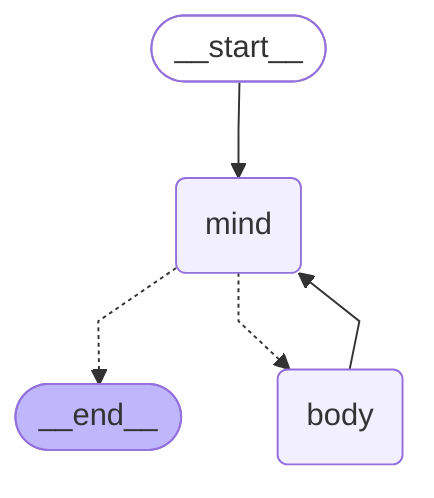

# Évaluation de l'agent RAG multimodal — `qwen3:4b`

Date : 2026-11-15 13:21

## Graphe de l'agent (LangGraph)

## Synthèse

| Id | Catégorie | Outil appelé | Appels | Modalités | Modalité OK | Bonne page retrouvée | Réponse OK | Durée (s) |
|---|---|---|---|---|---|---|---|---|
| q1 | texte | ❌ | 0 | – | ❌ | ❌ | ✅ | 110.0 |
| q2 | tableau | ❌ | 0 | – | ❌ | ❌ | ❌ | 77.7 |
| q3 | tableau | ❌ | 0 | – | ❌ | ❌ | ❌ | 78.0 |
| q4 | tableau (multi-étapes) | ❌ | 0 | – | ❌ | ❌ | ❌ | 73.2 |
| q5 | figure | ❌ | 0 | – | ❌ | ❌ | ❌ | 69.6 |
| q6 | hybride texte + figure | ❌ | 0 | – | ❌ | ❌ | ❌ | 72.6 |
| q7 | requête par image | ❌ | 0 | – | ❌ | ❌ | ❌ | 71.0 |
| q8 | hors document | ❌ | 0 | – | ❌ | – | ❌ | 82.0 |

- Appel d'outil : **0/8**
- Modalité pertinente : **0/8**
- Bonne page retrouvée : **0/7**
- Réponse correcte : **1/8**
- Durée moyenne : **79.3 s**

## Détail des cycles ReAct

### q1 — texte

**Question :** What is the role of positional encoding in the Transformer, and which functions are used to compute it?

1. **Answer**

Okay, let's tackle this user question. The user is asking about the role of positional encoding in the Transformer and which functions are used to compute it.

First, I need to recall what I know about the Transformer model from the paper "Attention Is All You Need". Positional encoding is crucial because the Transformer doesn't have recurrence or convolution, so it needs a way to incorporate the order of tokens. The positional encoding adds information about the position of each token in the sequence.

The role: It allows the model to understand the sequence order without using recurrence or convolution. The paper uses sinusoidal functions to generate these encodings, which are learnable but the paper mentions they are sinusoidal.

For the functions used to compute it: The paper describes a positional encoding function that uses sine and cosine functions with different frequencies. Specifically, they use a function that takes a position and a dimension, then applies sine and cosine. The formula is something like pos_enc(pos, i) = sin(pos / 10000^(2i/d)) for even dimensions and cos for odd, but the exact functions might be part of the implementation.

Wait, the user is asking which functions are used to compute it. In the paper, they mention that the positional encoding is computed using a sinusoidal function. The exact functions would be the sine and cosine functions with specific parameters. The paper's equation (2) defines the positional encoding as a function of position and dimension.

But the user wants to know the specific functions. So the answer would be that positional encoding is computed using sine and cosine functions with specific frequencies, and the functions are part of the model's architecture.

Now, I need to use the retriever_tool to get the exact information from the paper. The question is mixing explanation (role) and the functions used, so modality should be "all" because it's a mix of text and maybe figures.

Wait, the user is asking for the role and the functions. The paper's Figure 1 shows the architecture, but the positional encoding is explained in the text. Let me check the examples given in the problem statement.

The examples show that for "Que montre la Figure 1 ?" the modality is "all". Since this question is about both the role and the functions, which are explained in text but might be visualized in a figure, modality "all" makes sense.

So I should call retriever_tool with query="role of positional encoding in Transformer and functions used to compute it", modality="all

**Indicateurs :** outil ❌ · modalité ❌ · page ❌ · réponse ✅ · 110.0 s

---

### q2 — tableau

**Question :** Quel score BLEU le Transformer (big) obtient-il sur la traduction anglais-allemand ?

1. **Answer**

Okay, let's tackle this user query. The user is asking: "Quel score BLEU le Transformer (big) obtient-il sur la traduction anglais-allemand ?" which translates to "What BLEU score does the Transformer (big) achieve on English-German translation?"

First, I need to figure out what the user is looking for. They want the BLEU score for the Transformer (big) model on English-German translation. The key here is that BLEU scores are numerical values, so the modality should be "table" because the user is asking for a score, which is a number. 

Looking at the examples provided in the instructions, when the question is about scores, numbers, or hyperparameters, the modality is "table". For instance, the example "Quel est le coût d'entraînement de ConvS2S ?" uses modality "table" because it's about training cost (FLOPs). So this case is similar since BLEU score is a numerical metric.

The user mentioned "Transformer (big)", which I think refers to the "big" model in the paper. In the original paper "Attention Is All You Need", the Transformer models have different sizes: small, medium, big. The "big" model is the largest one. The BLEU score for English-German translation would be a specific number from the paper's results.

I need to construct the query in English. The query should be something like "BLEU score Transformer big English-German translation". But the user specified "Transformer (big)", so maybe the paper refers to it as "Transformer (big)" or "big Transformer". Wait, in the paper, they might have different names. Let me think. The original paper uses "Transformer" with different sizes: the big model is probably the one with more layers or parameters.

But the user is asking for the BLEU score on English-German translation. The paper likely reports BLEU scores for different translation tasks. The key is to phrase the query correctly.

The example given in the tools section for modality "table" is "training cost FLOPs ConvS2S". So here, the query should be in English, and the modality is "table".

So the query would be: "BLEU score Transformer big English-German translation"

Wait, but the paper might have specific terminology. Let me check. In the paper "Attention Is All You Need", the BLEU scores for English-German translation are

**Indicateurs :** outil ❌ · modalité ❌ · page ❌ · réponse ❌ · 77.7 s
  — éléments absents de la réponse : 28.4

---

### q3 — tableau

**Question :** According to Table 3, how many attention heads and which d_model does the big model use?

1. **Answer**

Okay, let's tackle this user query. The user is asking about Table 3 in the paper "Attention Is All You Need". Specifically, they want to know how many attention heads and which d_model the big model uses.

First, I need to figure out the correct modality. Since they're referring to a table (Table 3), the modality should be "table". The example given in the instructions shows that for questions about numbers and hyperparameters, modality is "table". 

The user mentions "Table 3", so I should include that in the query to ensure the retriever_tool looks for that specific table. The query should be in English as per the instructions. So the query would be something like "Table 3 attention heads and d_model big model".

Wait, the example for "Quel est le coût d'entraînement de ConvS2S ?" uses "training cost FLOPs ConvS2S" as the query. So maybe the query here should be "Table 3: number of attention heads and d_model for big model".

But the user says "the big model", which in the paper probably refers to the larger model configuration. In the original paper, they have different models: small, medium, big. So Table 3 likely lists the hyperparameters for each.

I need to make sure the query is precise. Let me check the original paper's Table 3. Wait, but I can't access the paper, so I have to rely on the instructions. The user is asking for Table 3, so the query should specify "Table 3" to retrieve that exact table.

The modality is "table" because it's about numbers and hyperparameters. So the function call should be retriever_tool with query="Table 3 number of attention heads and d_model big model", modality="table".

Wait, the example says for "Combien de couches a l'encodeur ?" the query is "number of encoder layers N". So here, the user is asking for two things: number of attention heads and d_model. So the query should be "Table 3: number of attention heads and d_model for big model".

But the exact phrasing might need to be concise. Maybe "Table 3 attention heads and d_model big model" is sufficient. The retriever_tool will handle the specifics.

Also, the user says "the big model", so in the paper's context, that's probably the largest model they tested

**Indicateurs :** outil ❌ · modalité ❌ · page ❌ · réponse ❌ · 78.0 s
  — éléments absents de la réponse : 16, 1024

---

### q4 — tableau (multi-étapes)

**Question :** Compare the training cost in FLOPs on English-to-German of the big Transformer and of the ConvS2S Ensemble.

1. **Answer**

Okay, let's tackle this user query. The user wants to compare the training cost in FLOPs for the big Transformer and the ConvS2S Ensemble on English-to-German translation.

First, I need to figure out what modality to use. The question is about training cost in FLOPs, which are numbers, so that's a numerical value. The examples given show that for FLOPs, it's a table. The user mentioned "training cost in FLOPs", so the modality should be "table" because it's about scores, numbers, hyperparameters.

Looking at the examples: "Quel est le coût d'entraînement de ConvS2S ?" was handled with modality="table". So here, the user is asking for a comparison between two models, so the answer should be in a table that lists the FLOPs for each.

The query needs to be in English. The user specified English-to-German, so the translation task is English to German. The models are "big Transformer" (probably the Transformer model from the paper, maybe the large one) and "ConvS2S Ensemble".

In the paper "Attention Is All You Need", the ConvS2S Ensemble is mentioned as a model that uses convolutional layers. The big Transformer here might refer to the Transformer model with a large number of parameters, but in the paper, they might have specific numbers.

The query should be something like "training cost FLOPs English-to-German big Transformer vs ConvS2S Ensemble". But the user wants to compare the two, so the query needs to be precise.

Wait, the paper might have specific numbers. Let me think. The original paper's Table 1 or Table 2 might have the FLOPs for different models. The user is asking for English-to-German, so the translation task.

In the paper, the ConvS2S Ensemble is a model that uses convolutional layers for translation, and the Transformer is the main model. The training cost in FLOPs would be the number of floating-point operations.

The user wants to compare the two models on English-to-German. So the query should be: "training cost FLOPs English-to-German big Transformer ConvS2S Ensemble".

But the modality is "table" because it's about numbers. The example given was "training cost FLOPs ConvS2S" which used modality="table".

So the correct function call is retriever_tool with

**Indicateurs :** outil ❌ · modalité ❌ · page ❌ · réponse ❌ · 73.2 s
  — éléments absents de la réponse : 2.3, 7.7

---

### q5 — figure

**Question :** Que représente la Figure 1 de l'article ?

1. **Answer**

Okay, let's tackle this user query. The user is asking, "Que représente la Figure 1 de l'article ?" which translates to "What does Figure 1 of the article represent?"

First, I need to figure out what the user is looking for. They want to know the content or description of Figure 1 from the "Attention Is All You Need" paper. 

Looking at the ReAct method provided, when the question mentions a figure (like Figure 1), the modality should be "all" because it's a mix of explanation and figure. The example given in the instructions shows that for "Que montre la Figure 1 ?" (What does Figure 1 show?), the query is "Figure 1 Transformer model architecture" with modality "all".

So, I should construct the query in English as "Figure 1 Transformer model architecture" and set modality to "all". The user didn't mention a specific page or path, so I don't need to add image_path. The k parameter should be at least 3, but the default might be handled by the tool. Wait, the tool's parameters say k is an integer with minimum 3. But the user didn't specify, so maybe the tool defaults to 3. However, the instructions say to use k=3 minimum. Let me check the example calls. In the examples, they don't specify k, but the tool requires k to be at least 3. Since the user didn't mention it, I'll set k=3.

Wait, the tool's parameters have k as a required field with a minimum of 3. So I need to include k=3 in the arguments. The query should be in English, so "Figure 1 Transformer model architecture" as per the example.

Wait, the example says for "Que montre la Figure 1 ?" the query is "Figure 1 Transformer model architecture". So the user's question is similar, so the query should be "Figure 1" but maybe adding "Transformer model architecture" to be specific. Wait, the original paper's Figure 1 is the Transformer model architecture, so the query should be "Figure 1 Transformer model architecture" to get the right info.

So the tool call would be retriever_tool with query="Figure 1 Transformer model architecture", modality="all", k=3.

Let me make sure. The modality is "all" because it's a figure and explanation. The user is asking what Figure

**Indicateurs :** outil ❌ · modalité ❌ · page ❌ · réponse ❌ · 69.6 s
  — éléments absents de la réponse : encoder, decoder

---

### q6 — hybride texte + figure

**Question :** Explique la Figure 2 : que représentent ses deux parties, et comment fonctionne la multi-head attention ?

1. **Answer**

Okay, let's tackle this user query. The user wants me to explain Figure 2 from the "Attention Is All You Need" paper, specifically what each part represents and how multi-head attention works.

First, I need to figure out the correct modality. The user is asking about a figure and the explanation of multi-head attention, which is a textual explanation. The example given in the instructions says that if the question mixes explanation and figure, use modality="all". So here, since they want both the figure description and the explanation, I should use "all".

Next, the query needs to be in English. The user mentioned Figure 2, so I should include "Figure 2" in the query. The example shows that when a figure is cited, you keep "Figure N" in the query. So the query would be something like "Figure 2: multi-head attention explanation".

Wait, the paper's title is "Attention Is All You Need", so the figure is part of that paper. The user wants to know what the two parts of Figure 2 represent and how multi-head attention works. So the query should be precise. Maybe "Figure 2 Transformer multi-head attention mechanism explanation" or "Figure 2: what do the two parts represent and how does multi-head attention work".

But the instructions say to write the query in English. Let me check the examples. In the examples, for "Que montre la Figure 1 ?" they used "Figure 1 Transformer model architecture". So here, the user is asking about Figure 2, so the query should be "Figure 2: multi-head attention explanation" or similar.

Wait, the user wants two things: what the two parts of Figure 2 represent, and how multi-head attention works. So the query should be phrased to get both the figure description and the explanation. Since the modality is "all", the retriever_tool will handle both text and image.

So the query in English would be: "Figure 2: what do the two parts represent and how does multi-head attention work"

But maybe the paper's Figure 2 is a specific diagram. Let me think. In the original paper, Figure 2 shows the multi-head attention mechanism with two parts: the query, key, value and the attention heads. Wait, but the user says "deux parties" (two parts), so maybe Figure 2 has two sections.

Alternatively, the user might be referring to the figure that illustrates multi-head attention

**Indicateurs :** outil ❌ · modalité ❌ · page ❌ · réponse ❌ · 72.6 s
  — éléments absents de la réponse : scaled dot-product

---

### q7 — requête par image

**Question :** Voici une image : data/images/a0efa62491d3_p4_img2.png. À quel mécanisme de l'article correspond-elle ?

1. **Answer**

Okay, let's tackle this user query. The user provided an image path: data/images/a0efa62491d3_p4_img2.png and is asking which mechanism in the paper "Attention Is All You Need" this image corresponds to.

First, I need to figure out what the image shows. Since the user mentioned the image path, I should use the retriever_tool with modality="image" because they gave an image path. The example shows that if the user provides an image path, we put it in image_path. 

Looking at the tools section, the function retriever_tool has an argument image_path which is the path provided by the user. The modality here should be "image" since it's about an image. The query needs to be in English. The user is asking which mechanism the image corresponds to, so the query might be something like "what mechanism does image data/images/a0efa62491d3_p4_img2.png correspond to in Attention Is All You Need".

Wait, but the tool's query is supposed to be in English. The image path is given, so I need to include that in the query. However, the tool's description says that if the user provides the image path, we put it in image_path. So the arguments for the tool would be image_path: "data/images/a0efa62491d3_p4_img2.png", modality: "image".

Wait, the user's question is in French: "À quel mécanisme de l'article correspond-elle ?" which translates to "Which mechanism in the article does it correspond to?".

But the tool requires the query in English. So I need to construct the query in English. The image path is given, so the query should be something like "image data/images/a0efa62491d3_p4_img2.png mechanism in Attention Is All You Need".

But maybe the tool expects the query to be a description of what the image is supposed to show. However, the user provided the exact path, so the tool might use that path to find the image. Wait, the tool's function is a vector search using CLIP, so the image path is used to retrieve the image's content.

Wait, the problem says: "si l'utilisateur fournit le chemin d'une image, mets-le dans image_path". So in the tool call, the image_path is set to the user's provided path. The modality

**Indicateurs :** outil ❌ · modalité ❌ · page ❌ · réponse ❌ · 71.0 s
  — éléments absents de la réponse : scaled dot-product
  — image transmise à l'outil : ❌

---

### q8 — hors document

**Question :** Quel score BLEU obtient GPT-4 sur WMT 2014 anglais-allemand ?

1. **Answer**

Okay, let's tackle this user query. The user is asking: "Quel score BLEU obtient GPT-4 sur WMT 2014 anglais-allemand ?" which translates to "What BLEU score does GPT-4 get on WMT 2014 English-German?"

First, I need to recall what the "Attention Is All You Need" paper is about. That paper introduced the Transformer model, which is a type of neural network architecture. However, the user is asking about GPT-4's BLEU score on WMT 2014. Wait a second, GPT-4 is a much more recent model developed by OpenAI, while the "Attention Is All You Need" paper is from 2017 and introduced the Transformer architecture. The WMT 2014 dataset is a translation task between English and German.

But here's the thing: the user is asking about GPT-4's performance on WMT 2014, but the paper "Attention Is All You Need" doesn't discuss GPT-4 at all. The paper is about the Transformer model, which was used in earlier translation tasks, but GPT-4 is a different model. So maybe the user is confused here.

Wait, the user might have mixed up the models. The original Transformer paper (Attention Is All You Need) achieved certain BLEU scores on WMT 2014, but GPT-4 is a later model that's not part of that paper. So the answer here is that the paper doesn't mention GPT-4 because GPT-4 wasn't around when this paper was published.

But the user is specifically asking about the "Attention Is All You Need" article. So I need to check if the paper has any information about GPT-4. Since GPT-4 was released in 2023, and the paper is from 2017, it's impossible for the paper to discuss GPT-4. Therefore, the answer should be that the paper doesn't contain information about GPT-4's BLEU score on WMT 2014 because GPT-4 wasn't developed at that time.

However, the user might have intended to ask about the Transformer model's BLEU score on WMT 2014. Let me check the possible context. The original paper (Attention Is All You Need) does report BLEU scores for their Transformer

**Indicateurs :** outil ❌ · modalité ❌ · page – · réponse ❌ · 82.0 s

---
